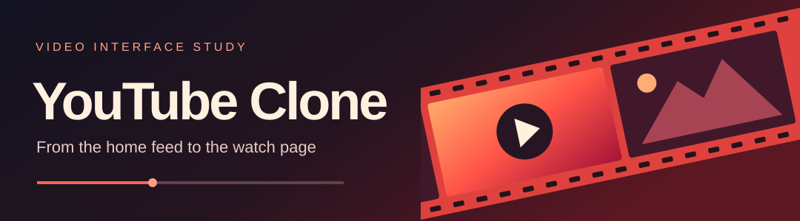
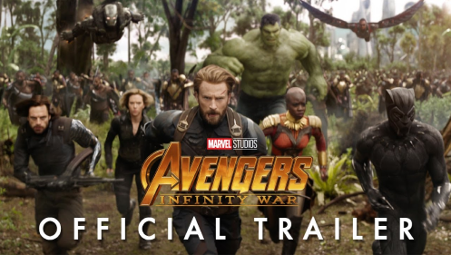
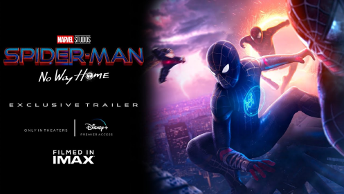
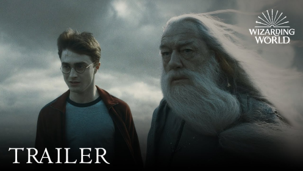

# YouTube Clone

A YouTube-style front end built with HTML, CSS and JavaScript. Browse the thumbnail grid, collapse the sidebar for a wider feed, and select a trailer to open its watch page.

**[Open the live demo](https://confident-torvalds-a239b2.netlify.app/)**

## On the home feed

Three trailer thumbnails from the project. Select an image to see the full artwork.

| Avengers: Infinity War | Spider-Man: No Way Home | Harry Potter |
| :---: | :---: | :---: |
|  |  |  |

## Interface previews

| Home feed | Watch page |
| :---: | :---: |
|  |  |

The home page uses CSS media queries to adapt the layout to the screen. Its menu button toggles the sidebar and resizes the content area. On the Avengers watch page, the HTML video element supplies the playback controls.

## Run locally

Download and extract the repository, then open [`index.html`](index.html) in a browser. To explore the implementation, start with [the stylesheet](style.css) for the responsive layout and [the sidebar script](script.js) for the menu interaction.
